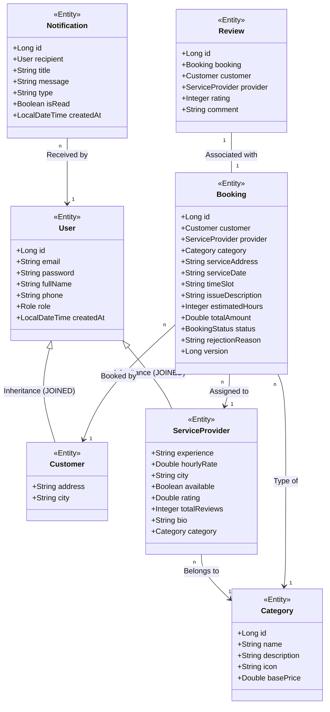
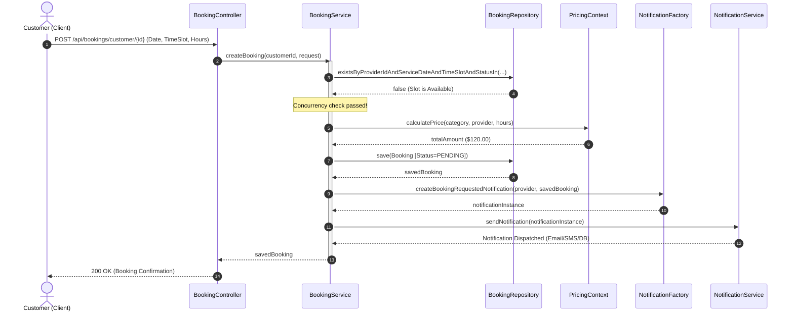
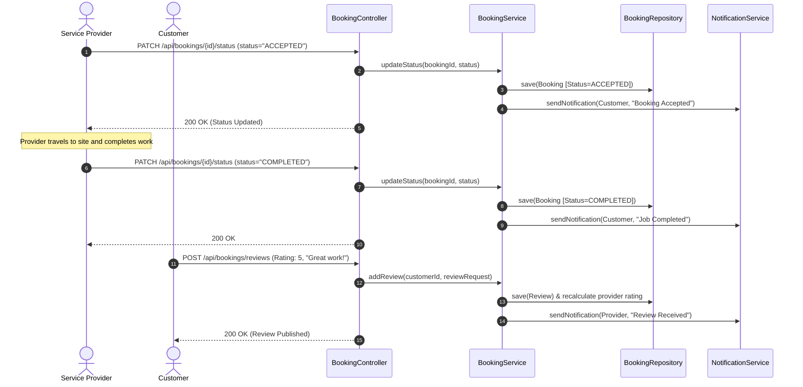

# Low-Level Design (LLD) & System Architecture Specification
## Skilled Service Provider Booking Platform (ProFix)
**Capstone Final Assessment & Evaluation Document**

---

## 1. Requirement Analysis

### 1.1 Actors
1. **Customer**: Searches for local tradespeople, books appointment slots, tracks status, cancels, and rates completed jobs.
2. **Service Provider**: Manages skill profile, toggles real-time availability, accepts or rejects requests, and advances job stages.
3. **Platform Administrator**: Manages category taxonomy & base fees, audits all system bookings, monitors revenue, and reviews user activity.
4. **Notification Engine**: System actor that asynchronously delivers alerts to customers and workers upon lifecycle state transitions.

### 1.2 Functional Requirements (FR)
- **FR1 (Authentication & Authorization)**: Role-based JWT access for Customer (`ROLE_CUSTOMER`), Provider (`ROLE_PROVIDER`), and Admin (`ROLE_ADMIN`).
- **FR2 (Service Discovery)**: Category exploration (Electrician, Plumber, Carpenter, Painter, Mason) with filters for availability and city.
- **FR3 (Booking Lifecycle Management)**: State transitions strictly enforced:
  `PENDING` ➔ `ACCEPTED` ➔ `IN_PROGRESS` ➔ `COMPLETED` / `CANCELLED` / `REJECTED`.
- **FR4 (Transparent Pricing Strategy)**: Dynamic pricing computed from category base rate + (estimated hours × provider hourly rate).
- **FR5 (Concurrency Control & Conflict Prevention)**: A provider cannot be booked for overlapping slots on the same date.
- **FR6 (Review & Rating System)**: One review per completed booking with dynamic recalculation of provider rating averages.
- **FR7 (Admin CRUD & Observability)**: Category addition/editing and full-platform transaction audits.

### 1.3 Non-Functional Requirements (NFR)
- **NFR1 (Data Consistency & Concurrency)**: Isolated transactions (`REPEATABLE_READ`) and optimistic locking via JPA `@Version` prevent lost updates and double bookings.
- **NFR2 (Security)**: Stateless JWT tokens, password hashing with BCrypt (10 rounds), protected API endpoints via Spring Security method security.
- **NFR3 (Scalability & Extensibility)**: Clear separation of concerns (Controller ➔ Service ➔ Repository) and strategy interfaces allowing plug-and-play notification channels and pricing models.
- **NFR4 (Performance & Latency)**: Sub-100ms API query response times with pagination (`Pageable`) and indexed foreign keys.

---

## 2. Class Diagram (UML Representation)



---

## 3. Object-Oriented Design (OOD)
- **Abstraction**: `PricingStrategy` and `NotificationSender` interfaces abstract pricing calculations and communication protocols away from core domain workflows.
- **Encapsulation**: Domain models protect state via private fields, validation constraints, and public accessors; business invariant logic is concentrated in `@Service` layers.
- **Inheritance**: `User` superclass extended by `Customer` and `ServiceProvider` using JPA `InheritanceType.JOINED` avoids schema duplication while allowing role-specific fields.
- **Polymorphism**: The `NotificationService` calls `.send()` on a list of `NotificationSender` instances; dynamic dispatch invokes both `EmailNotificationSender` and `SmsNotificationSender`.

---

## 4. SOLID Principles Mapping

| Principle | Code Location | How It Is Satisfied |
|---|---|---|
| **Single Responsibility (SRP)** | `PricingContext`, `NotificationService`, `BookingService` | Each class has a single reason to change: `PricingContext` solely handles pricing logic, `NotificationService` handles dispatching alerts, and `BookingService` manages the booking lifecycle. |
| **Open/Closed (OCP)** | `PricingStrategy`, `NotificationSender` | New pricing schemes (e.g. `WeekendSurgePricing`, `HolidayDiscountPricing`) or notification mediums (e.g. `WhatsAppNotificationSender`) can be added without altering existing booking engine code. |
| **Liskov Substitution (LSP)** | `Customer`, `ServiceProvider` extending `User` | Anywhere a `User` entity is expected (e.g. JWT authentication, notification recipient), instances of `Customer` or `ServiceProvider` can be substituted cleanly without breaking system behavior. |
| **Interface Segregation (ISP)** | `NotificationSender`, `PricingStrategy`, `UserRepository` | Small, client-specific interfaces rather than monolithic contracts. Consumers only depend on methods they actually need. |
| **Dependency Inversion (DIP)** | `NotificationService` -> `NotificationSender` | High-level `NotificationService` does not instantiate or directly depend on low-level SMS or Email clients; both depend on the `NotificationSender` abstraction. |

---

## 5. Design Patterns Implementation

### 5.1 Strategy Pattern (Behavioral)
- **Use Case**: Transparent price calculation based on service type, hours, and dynamic factors (standard vs. surge pricing).
- **Classes**: `PricingStrategy` (interface), `StandardPricingStrategy` (concrete), `SurgePricingStrategy` (concrete), `PricingContext` (context).

### 5.2 Factory Pattern (Creational)
- **Use Case**: Encapsulated creation of distinct lifecycle notifications (`createBookingRequestedNotification`, `createStatusChangedNotification`, `createReviewReceivedNotification`).
- **Classes**: `NotificationFactory`.

### 5.3 Observer Pattern / DIP Dispatcher (Behavioral)
- **Use Case**: Decoupled notification dispatch to multiple subscribers/channels upon booking creation or status change.
- **Classes**: `NotificationService`, `NotificationSender`, `EmailNotificationSender`, `SmsNotificationSender`.

### 5.4 State Pattern (Behavioral)
- **Use Case**: Finite State Machine enforcing legitimate booking lifecycle transitions (`PENDING` ➔ `ACCEPTED` ➔ `IN_PROGRESS` ➔ `COMPLETED`).

---

## 6. Sequence Diagrams

### 6.1 Booking Creation & Double-Booking Prevention Flow



### 6.2 Provider Request Acceptance & Job Completion Flow



---

## 7. Database Schema & Indexing

```sql
-- Categories Table
CREATE TABLE categories (
    id BIGSERIAL PRIMARY KEY,
    name VARCHAR(255) NOT NULL UNIQUE,
    description TEXT,
    icon VARCHAR(100),
    base_price DOUBLE PRECISION NOT NULL
);

-- Users Table (Base entity for Joined Inheritance)
CREATE TABLE users (
    id BIGSERIAL PRIMARY KEY,
    email VARCHAR(255) NOT NULL UNIQUE,
    password VARCHAR(255) NOT NULL,
    full_name VARCHAR(255) NOT NULL,
    phone VARCHAR(50) NOT NULL,
    role VARCHAR(50) NOT NULL,
    created_at TIMESTAMP DEFAULT CURRENT_TIMESTAMP
);
CREATE INDEX idx_users_email ON users(email);

-- Customers Subtable
CREATE TABLE customers (
    id BIGINT PRIMARY KEY REFERENCES users(id) ON DELETE CASCADE,
    address VARCHAR(255),
    city VARCHAR(100)
);

-- Service Providers Subtable
CREATE TABLE service_providers (
    id BIGINT PRIMARY KEY REFERENCES users(id) ON DELETE CASCADE,
    category_id BIGINT REFERENCES categories(id),
    experience VARCHAR(100),
    hourly_rate DOUBLE PRECISION,
    city VARCHAR(100),
    available BOOLEAN DEFAULT TRUE,
    rating DOUBLE PRECISION DEFAULT 5.0,
    total_reviews INT DEFAULT 0,
    bio TEXT
);
CREATE INDEX idx_providers_category ON service_providers(category_id);
CREATE INDEX idx_providers_available ON service_providers(available);

-- Bookings Table (Core transaction table)
CREATE TABLE bookings (
    id BIGSERIAL PRIMARY KEY,
    customer_id BIGINT NOT NULL REFERENCES customers(id),
    provider_id BIGINT NOT NULL REFERENCES service_providers(id),
    category_id BIGINT NOT NULL REFERENCES categories(id),
    service_address VARCHAR(255) NOT NULL,
    service_date VARCHAR(50) NOT NULL,
    time_slot VARCHAR(50) NOT NULL,
    issue_description TEXT,
    estimated_hours INT DEFAULT 2,
    total_amount DOUBLE PRECISION,
    status VARCHAR(50) NOT NULL,
    rejection_reason VARCHAR(255),
    created_at TIMESTAMP DEFAULT CURRENT_TIMESTAMP,
    updated_at TIMESTAMP DEFAULT CURRENT_TIMESTAMP,
    version BIGINT DEFAULT 0
);
-- Composite Index for fast double-booking conflict resolution:
CREATE INDEX idx_bookings_concurrency ON bookings(provider_id, service_date, time_slot, status);

-- Reviews Table
CREATE TABLE reviews (
    id BIGSERIAL PRIMARY KEY,
    booking_id BIGINT NOT NULL UNIQUE REFERENCES bookings(id),
    customer_id BIGINT NOT NULL REFERENCES customers(id),
    provider_id BIGINT NOT NULL REFERENCES service_providers(id),
    rating INT NOT NULL CHECK (rating >= 1 AND rating <= 5),
    comment TEXT,
    created_at TIMESTAMP DEFAULT CURRENT_TIMESTAMP
);
CREATE INDEX idx_reviews_provider ON reviews(provider_id);

-- Notifications Table
CREATE TABLE notifications (
    id BIGSERIAL PRIMARY KEY,
    recipient_id BIGINT NOT NULL REFERENCES users(id),
    title VARCHAR(255) NOT NULL,
    message TEXT NOT NULL,
    type VARCHAR(100),
    is_read BOOLEAN DEFAULT FALSE,
    created_at TIMESTAMP DEFAULT CURRENT_TIMESTAMP
);
CREATE INDEX idx_notifications_recipient_read ON notifications(recipient_id, is_read);
```

---

## 8. Error Handling, Validation, and Edge Cases
1. **Double Booking Prevention**:
   - Repository query verifies if an active booking (`ACCEPTED`, `IN_PROGRESS`) already exists for that provider at the requested `serviceDate` and `timeSlot`.
   - Throws `BookingConflictException` which responds with HTTP `409 Conflict`.
2. **DTO Request Validation**:
   - Jakarta `@Valid`, `@NotBlank`, `@Email`, `@Size`, `@Min` annotations validate input before service execution.
   - Handled uniformly via `@RestControllerAdvice` (`GlobalExceptionHandler`) returning structured validation error maps.
3. **Invalid State Transition Guard**:
   - Customers cannot review uncompleted jobs or cancel completed jobs.
   - Throws `BadRequestException` (HTTP `400`).
4. **Optimistic Locking**:
   - JPA `@Version` column on `Booking` entity detects concurrent modifications and throws `OptimisticLockException` preventing silent data overwriting.
